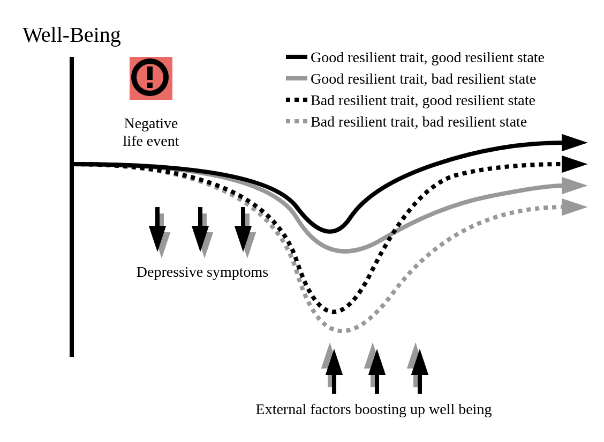
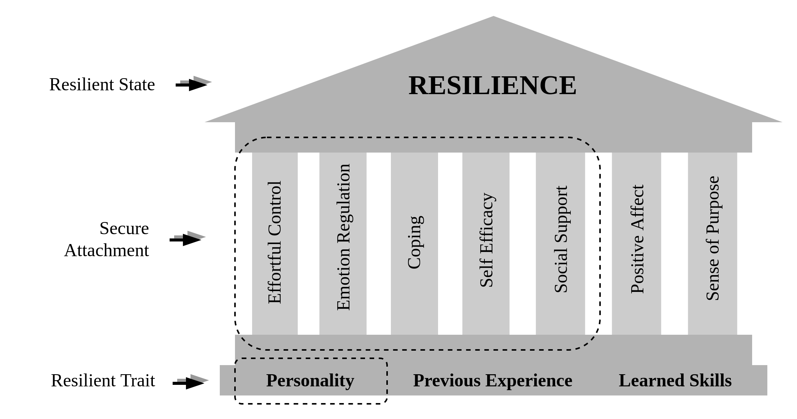
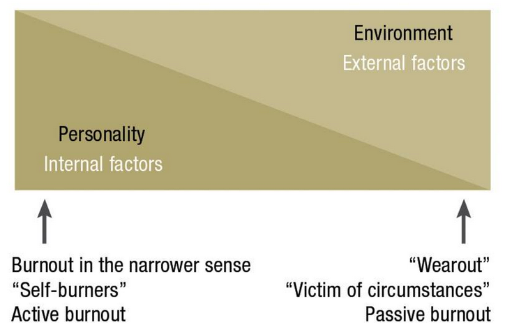
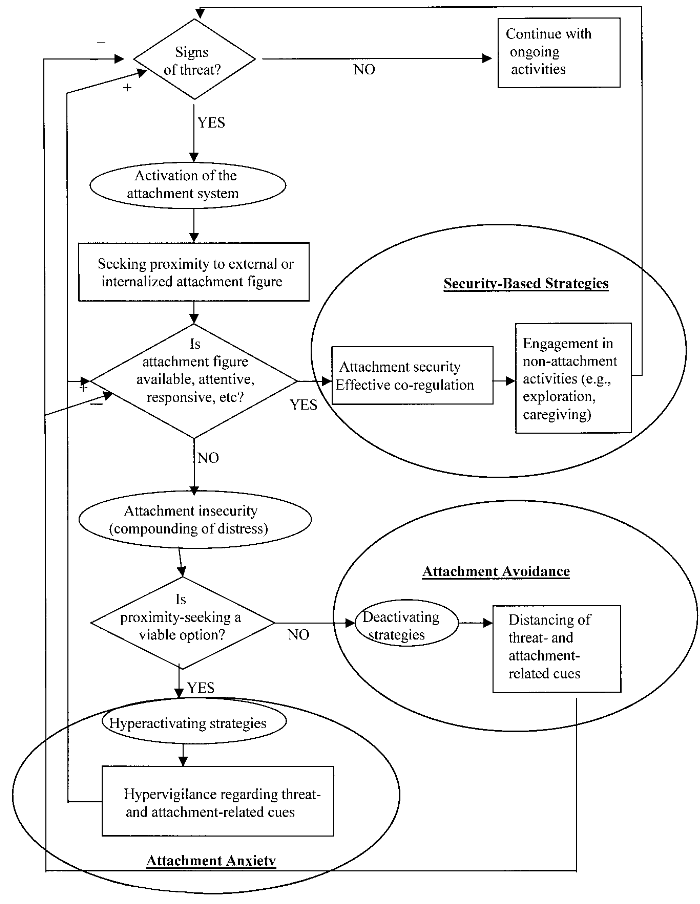
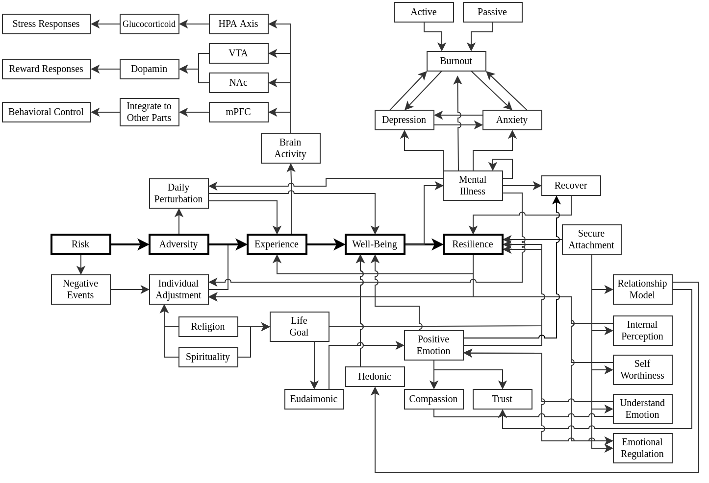

```{r init}

pkgs <- c("magrittr")
pkgs_load <- sapply(pkgs, library, character.only = TRUE)

gbd    <- readRDS("../RData/gbd-mental-illness/gbd_describe")
groups <- gbd[[1]]$group %>% set_names(gsub(x = ., "\\W", "_"))

gbd_stats <- lapply(groups, function(grp) {
  lapply(gbd, \(tbl) tbl %>% subset(.$group == grp, select = -group)) %>%
    {do.call(rbind, .)} %>%
    inset2("stat", value = rownames(.)) %>%
    tidyr::pivot_longer(daly_depress:prev_eat_disorder) %>%
    inset(c("metrics", "psych"), value = list(
      "metrics" = gsub(x = .$name, "_.*", ""),
      "psych"   = gsub(x = .$name, ".*_", "")
    ))
})

reportGBD <- function(gbd_stat, m, p) {
  arr <- gbd_stat %>%
    subset(
      subset = {
        .$stat %in% c("mean", "sd") & .$metrics == m & .$psych == p
      },
      select = value
    ) %>%
    extract2(1) %>%
    round(2)

  msg <- "%s%s [%s]"

  if (m == "prev") {
    msg <- sprintf(msg, arr[[1]], "%", arr[[2]])
  } else {
    msg <- sprintf(msg, arr[[1]], "", arr[[2]])
  }

  return(msg)
}

```

# Literature Review

This chapter focuses on elaborating theories and findings pertaining to resilience and psychological outcomes. @sec-motivation elaborates the motivation behind this research, including the economic evaluation of mental disorders. @sec-attachment summarizes child-parent attachments as proposed by @bowlby1973attachment and @ainsworth1979infant. @sec-resilience explains the scope and context of mental resilience in this research. @sec-neurobio-resilience outlines the underlying neurobiological mechanism in psychological resilience. @sec-stressor defines a set of stressors investigated in this research, which will be the generic precipitators of maladaptive behavior. @sec-psych justifies the psychological outcomes.

## The Definition of Adversity and Positive Outcomes

This study refers to adversity as the presence of challenging or harmful circumstances that require psychological adaptation. Conceptually, adversity is the interface between external risk factors and the individual's subjective experience of difficulty [@vella2019theoretical]. While adversity can be examined in terms of statistical associations between adverse life events and adjustment, it may also be identified without a formal statistical threshold, for example through self-reported experiences of significant difficulty. In this study, adversity is quantified as the degree of perceived difficulty, implying adversity as an ongoing or recurrent challenge in daily life [@vella2019theoretical]. Perceived difficulty will be measured using the Perceived Stress Scale (PSS-10), which has been adapted and validated for use in the Indonesian population.

Positive outcomes are defined as indicators of successful adaptation following adversity, such as maintaining, regaining, or surpassing prior levels of psychological and social functioning. Following @vella2019theoretical, a positive outcome may include prevention of mental illness, reduction in symptom severity, or sustained subjective well-being despite exposure to risk. Our study operationalizes positive outcomes as lower levels of depression, anxiety, and burnout. Each outcome will be measured by Patient Health Questionnaire-9 (PHQ-9) for depression, Generalized Anxiety Disorder-7 (GAD-7) for anxiety, and Maslach Burnout Inventory (MBI) for burnout, which have also been adapted and validated for use in the Indonesian population.

## The Definition of Resilience

Building on the definitions of adversity and positive outcomes, resilience refers to the capacity to adapt effectively to negative setback in life. @Bonanno2008 distinguishes resilience from recovery: recovery implies the presence of pathological symptoms that gradually dissipate over time, whereas resilience describes the ability to maintain well-being equilibrium in the face of adversity. Importantly, resilience is distinct from merely the absence of psychological problems. Resilient individuals may experience temporary perturbations in daily functioning, such as sporadic preoccupations, restless sleep, or transient sadness, without developing a disorder.

@infurna2016resilience notes that resilience can also be observed in individuals recovering from psychological disorders, suggesting that resilience functions both as a stable trait and as a dynamic state that facilitates recovery. Both @Bonanno2008 and @infurna2016resilience conceptualize resilience along a continuum, where trait resilience establishes a baseline threshold against adversity, and state resilience serves as a dynamic buffer connecting baseline capacity to recovery outcomes. @Luthar2000 emphasizes the importance of defining resilience as a trait or state, proposing the state of resilience as "*a dynamic process encompassing positive adaptation within the context of significant adversity.*"

To illustrate these concepts, @fig-define-resilience presents a hypothetical model of how trait and state resilience contribute to the trajectory of well-being over time. In this model, trait resilience represents the underlying psychological capacity to withstand adversity, while state resilience functions as a buffer that promotes recovery and adaptation when negative setbacks occur. These theoretical distinctions guide the operationalization of resilience in this study, linking conceptual understanding to measurable constructs.

```{r}
#| label: fig-define-resilience
#| fig.cap: "Theoretical conceptualization on how resilience affects the well-being trajectory over time"
#| out.width: "80%"
#| fig-align: "center"



```

## Constituents of Resilience

Resilience is supported by three interrelated psychological factors, namely secure attachment, positive emotions, and a sense of purpose in life [@rutten2013resilience]. These factors form the foundation of mental health, helping individuals maintain well-being when facing adversity and facilitating the recovery process. Secure attachment, established through early caregiver-child interactions, provides children with an internal working model for interpreting social relationships and managing emotions [@atwool2006attachment]. Positive emotions enhance coping capacity, build trust, and strengthen life satisfaction even under stress [@Cohn2009; @Waugh2020]. Meanwhile, a sense of purpose fosters well-being, guiding personal growth and promoting optimism [@Kaczmarek2017; @Kim2021].

Secure attachment emerges during early childhood as a product of consistent, responsive caregiving, forming an internal working model that guides how children perceive themselves, others, and the environment [@rutten2013resilience; @atwool2006attachment]. Children with secure attachment tend to see themselves as worthy, others as reliable, and challenges as manageable. This internal model facilitates the effective self-regulation, emotional understanding, and social competence, which are critical for navigating adversity. As the internal model consolidates by around age five, it continues to influence the child's capacity to respond adaptively to stress and develop resilience throughout life. Secure attachment empowers children with self-regulation, empathy, and the capacity to manage interpersonal relationships [@atwool2006attachment].

Positive emotions play a crucial role in psychological well-being and resilience, often outweighing the impact of negative emotions in promoting mental health [@rutten2013resilience; @Cohn2009]. Experiencing positive emotions, even temporarily, enhances trust, compassion, and adaptive coping, also strengthens the link between resilient traits and life satisfaction [@Cohn2009; @Nylocks2018; @Waugh2020]. Positive emotions also buffer the perception of adversity, facilitating recovery from stress [@Waugh2015]. While individual differences exist, these variations are modest once social and interpersonal stressors are accounted for. In sum, cultivating positive emotions supports coping processes and contributes to the development and maintenance of a resilient state [@Tugade2006].

Beyond secure relationships or moments of happiness, having a clear and enduring purpose in life promotes a deeper and more lasting contribution to resilience [@rutten2013resilience; @Kaczmarek2017]. Such a purpose gives direction, encourages the pursuit of personally meaningful goals, and supports the development of the innate potential. Over time, maintaining the sense of purpose contribute to well-being by fostering optimism and lowering the risk of depression and loneliness [@Kim2021]. When individuals feel connected to their values and life direction, religion and spirituality can play an important role in reinforcing resilience, particularly for those who have limited opportunities for social interaction [@Chan2018; @rutten2013resilience]. While the drive to find meaning in life is unique to each person and often deeply personal [@Disabato2016], it does not depend solely on internal reflection. Shaping one's surroundings to encourage purposeful action can also strengthen resilience and help maintain a coherent sense of self and the world [@rutten2013resilience].

```{r}
#| label: fig-seven-pillars
#| fig.cap: "Seven pillars of a resilient state, as adapted from @precious2019mental also @rutten2013resilience"
#| out.width: "90%"
#| fig-align: "center"



```

Considering resilience as a dynamic psychological state, several factors contribute to its development. @precious2019mental proposed seven main pillars supporting resilience, which can be derived from the three psychological factors introduced by @rutten2013resilience. In @fig-seven-pillars, five pillars are attributed to secure attachment, while the remaining two reflect positive emotion and purpose in life, respectively.

First, secure attachment between children and parental figures positively correlates with resilience [@Gilliom2002; @Viddal2015; @Shi2020], mediated by the development of effortful control. Effortful control is a volitional ability to generate adaptive responses that reflects self-regulation. Children with secure attachments are more likely to develop effective self-regulation, which reduces tendencies toward aggression [@Stifter2008; @Liu2004]. While @Gilliom2002 observed this association primarily in boys, @Shi2020 demonstrated that in adults, gender differences in self-regulation are minimal, suggesting that early secure attachment fosters self-regulatory capacities across gender in later life [@Heylen2016]. Longitudinal research indicates that effortful control in early adolescence correlates with resilience at each time point, although both traits may fluctuate over time [@Nair2020; @Eisenberg2009]. Collectively, secure attachment promotes the consolidation of self-control, which serves as a foundation for resilient behaviors.

Second, emotion regulation is a central component in developing resilience that is deeply influenced by the quality of attachment between children and their caregivers [@Cassidy1994]. From the first year of life, children begin to form internal working models based on their interactions with caregivers. Internal working model is a mental representations of how the world responds to their emotional needs. Securely attached children learn to expect that their feelings will be acknowledged and supported. This reliable responsiveness encourages children to express and discuss their emotions openly, fostering the development of effective strategies for managing emotional responses from caregivers. Those with avoidant attachment tend to repress emotions and recall negative experiences in a muted way, while children with anxious attachment vividly remember negative events and remain preoccupied with them [@bowlby1973attachment; @hinde1996attachment; @bretherton2013origins; @Mikulincer2019]. Both avoidant and anxious attachment patterns are associated with fragile emotion-regulation abilities and a reduced capacity to cope with prolonged or uncontrollable stressors. Emotion regulation develops as a specialized skill that integrates both child's temperament and child-parent attachment, allowing children to exercise attentional control and cognitive reappraisal to manage emotional responses. By reducing the intensity and duration of negative emotion, these strategies help maintain psychological balance and contribute to the emergence of a resilient state [@kay2016emotion].

Third, effective coping fosters psychological growth by enabling individuals to adapt through consistent exposure to daily stressors. The emergence of a resilient state depends not only on the availability of intrinsic and extrinsic factors, but also on the experience of manageable stress that actively strengthens regulatory capacity [@DiCorcia2011]. A gradual exposure to such stressors challenges individuals to push their limits, and in turn fostering endurance and more effective coping skills. This process provides opportunities to practice adaptive responses that incrementally improve resilience. Within this dynamic, positive emotions plays a critical role in reconciling negative emotions during moments of stress, thereby facilitating the use of mature coping strategies [@Ong2006]. In addition, adaptive self-reflection serves as a key mechanism for reinforcing resilience. This reflective practice involves five sequential steps, namely cultivating emotional awareness, identifying trigger, reappraising the stressor, evaluating the response, and adopting a future-oriented perspective [@Crane2018; @Goodvin2008; @hamarta2009attachment]. The first three steps focus on understanding and responding to the immediate situation, while the latter two emphasize growth and preparedness for future challenges. Emotional awareness entails recognizing internal shifts in reaction to triggering events. Trigger identification helps establish the causal link between stressors and responses. Reappraisal leverages these insights to frame stressors in a more constructive light, enabling a more goal-aligned reaction. Response evaluation is an emotionally distanced review of the situation aimed at improving the effectiveness of future responses. Finally, future-oriented planning emphasizes actionable strategies to address similar challenges moving forward. Through consistent practice of these processes, individuals not only process adversity more effectively but also sustain psychological stability over time [@Tronick2015].

Fourth, self-efficacy develops from early-life experiences of secure attachment, which lay the foundation for positive internal working models that guide a positive self-perception. Self-efficacy represents an individual's belief in their ability to attain desired goals, shaped by self-referent expectations and the capacity for reflective thought [@Bandura1978]. Self-efficacy is inherently task-specific, meaning a person may display strong confidence in one domain yet feel uncertain in another. Processing high self-efficacy equips individuals to recover from setbacks, maintain sustained effort under pressure, and respond constructively to negative feedback [@heslin2006self]. In contrast, low self-efficacy often heightens vulnerability to anxiety or depression, as individuals may interpret feedback through assumptions of incompetence or incapacity. Empirical evidence indicates that both self-efficacy and self-care serve as partial mediators between attachment style and resilience, suggesting that secure attachment fosters a strong, positive belief in personal capability [@Bender2018]. Confidence in one's capacity promotes effective behavior, which in turn validates and strengthens that belief [@Bandura1996]. In this way, self-efficacy fuels affective, motivational, and behavioral mechanisms that enable individuals to sustain resilient attitudes and adaptive behaviors amidst challenging circumstances [@Schwarzer2012].

Fifth, social support is intrinsically linked to social competencies that originate from early child-parent attachment experiences. A secure attachment fosters the development of a positive internal working model of the social environment, which strengthens the belief in the availability and reliability of social support. Conversely, insecure attachment often results in a negative working model, characterized by fear of intimacy and a tendency toward social withdrawal. These working models are foundational to the maturation of social competencies, which @Mallinckrodt2005 defines as the essential skills for establishing and maintaining supportive social relationships. Two central components of these competencies are social self-efficacy and emotional awareness. Social self-efficacy is the confidence to initiate and cultivate connections from initial acquaintances. Emotional awareness is the ability to recognize and understand one's own emotions and those of others. Individuals with secure attachment and a positive working model generally display higher levels of these competencies, while those with a negative working model often show deficits in one or both. For example, an anxious attachment style is frequently associated with social uncertainty, a sense of powerlessness, and difficulty sustaining close relationships. In contrast, avoidant attachment may manifest as affective disengagement, where individuals repress emotional perception [@Mallinckrodt2005]. Maintaining strong social ties is critical for securing access to both psychological and material resources, thereby enhancing one's capacity to cope with adversity [@Cohen2004]. As argued by @sippel2015does, social support serves as a moderating factor for genetic and environmental vulnerabilities, enabling individuals to display resilience. Such support fosters stress-regulating behaviors, bolsters self-confidence, encourages mature coping strategies, promotes effective emotion regulation, and strengthens the resilient state.

## Observing Trait and State Resilience

Resilience, both as a trait and state, contributes to maintaining psychological well-being by reducing or buffering the negative effects from experiencing adversities. @hu2015meta characterized trait resilience as more innate and stable, which supports classifying individuals into resilient and less resilient groups. However, measuring resilience only as a trait risks underestimating its occurrence and variability in the population. For example, @GhaneiGheshlagh2017 reported high heterogeneity across studies that used instruments such as the CD-RISC^[Connor-Davidson Resilience Scale; 25 items], the RSA^[Resilience Scale for Adults; 33 items], and the ERS^[Essential Resilience Scale; 15 items]; this heterogeneity may reflect differences in instruments, study samples, timing of assessment, and contextual factors rather than a single source. Both @GhaneiGheshlagh2017 and Hu et al. [-@hu2015meta] noted that higher resilience is associated with lower depression, anxiety, and negative affect.

This research focuses on state resilience in favor of policy-making and intervention relevance. State resilience is potentially modifiable and therefore a plausible target for programs intended to reduce the mental health impact of adversity. While trait resilience is valuable for identifying at-risk groups, state resilience offers actionable targets for interventions and mental health policies. Operationally, state resilience will be treated as a time-varying construct and measured with scales that are sensitive to change and validated for the Indonesian context. This is to ensure that the findings can inform strategies to strengthen adaptive responses to stress and adversity.

## The Scope of Mental Health Burden {#sec-motivation}

Using Global Burden of Diseases (GBD) data from 1990 to 2019, @owidmentalhealth described the scope of problem with mental illnesses, reported as prevalence and disability-adjusted life years (DALY). The GBD dataset enlists 206 countries and 22 country groups according to the World Health Organization, United Nation, and World Bank classification. The clinical diagnoses included in the GBD dataset is depressive disorder, anxiety disorder, bipolar disorder, eating disorder, and schizophrenia. The author replicated this approach in table [-@tbl-summary] - [-@tbl-cor-gbd-4] to elucidate the regional issues based on country-level income grouping. Interestingly, depression is the most prevalent in low-income countries ($\bar{x}$ [$\sigma$]^[$\bar{x}$ $[\sigma]$: mean [standard deviation]] = `r reportGBD(gbd_stats$Low_Income, "prev", "depress")`) and the least prevalent in middle-income country (`r reportGBD(gbd_stats$Middle_Income, "prev", "depress")`). Meanwhile, anxiety is the most prevalent in high-income countries (`r reportGBD(gbd_stats$High_Income, "prev", "anxiety")`) and the least prevalent in lower-middle-income countries (`r reportGBD(gbd_stats$Lower_Middle_Income, "prev", "anxiety")`). The strong and positive association between DALY and prevalence implies the more occurring cases is closely related with increasing burden of diseases. @tbl-cor-gbd-1 - [-@tbl-cor-gbd-4] show that all mental illnesses present with cross association, though with a different pattern occurring in high-level income countries compared to the others. Specifically looking at depression and anxiety, high-income countries presented with a positive association while other countries presented with negative associations. To further address this issue, @Kessler2006 with the Assessment, Classification, and Evaluation Group at the WHO initiated World Mental Health (WMH) survey. WMH complements GBD by providing insight on validated mental health burden worldwide, by incorporating the use of lay-administered Composite International Diagnostic Interview for DSM-IV [@who2004prevalence].

```{r tbl-summary}
#| tbl-cap: Descriptive statistics of mental health indicators from GBD dataset, adapted from @owidmentalhealth

readRDS("../RData/gbd-mental-illness/gbd_report")

```

```{r tbl-cor-gbd-1}
#| tbl-cap: Pairwise correlation of mental illnesses metrics in high-income countries
gbd_cor <- readRDS("../RData/gbd-mental-illness/gbd_cor")
knitr::kable(gbd_cor$high_income)

```

```{r tbl-cor-gbd-2}
#| tbl-cap: Pairwise correlation of mental illnesses metrics in middle-income countries

knitr::kable(gbd_cor$middle_income)

```

```{r tbl-cor-gbd-3}
#| tbl-cap: Pairwise correlation of mental illnesses metrics in lower middle-income countries

knitr::kable(gbd_cor$lower_middle_income)

```

```{r tbl-cor-gbd-4}
#| tbl-cap: Pairwise correlation of mental illnesses metrics in low-income countries

knitr::kable(gbd_cor$low_income)

```

@who2004prevalence highlighted that the combined global prevalence of any mental disorder is ranging from 4.3% to 26.4%, where the most reported cases are anxiety disorder (2.4%-18.2%), mood disorder (0.8%-9.6%), and substance abuse (0.1%-6.4%). While the proportion of severe cases (0.4%-7.7%) in any diagnosis is comparably lower than the prevalence of moderate (0.5%-9.4%) and mild cases (1.8%-9.7%), the impact to productivity is astounding. At least 30 productive days are lost among subjects reporting any severe mental disorder (IQR: 32.1-38.4 days), and accordingly, the number of day loss is lower in subjects with moderate (IQR: 9.2-18.8 days) or mild cases (IQR: 0.1-3.6 days). However, not all cases receives adequate treatment, where the proportion of people receiving treatment is ranging from 0.8% to 15.3% of the affected population. Even though severe cases are more likely to be diagnosed and treated, up to 50.3% of severe cases in developed countries and 85.4% of severe cases in less-developed countries receive no treatment. The proportion of untreated subjects is even higher in moderate and mild cases, ranging from 50%-90.3% and 64.8%-99.5%, respectively. In a follow-up study using WMH data, @Kessler2009 reported that early-onset mental disorders significantly predict a wide range of physical disorders and reduced achievements in a number of role domains. Furthermore, productivity loss due to major depressive disorder in the United States alone is over five weeks of productive-day loss per year, approximated to USD 36 billion of economical loss. Similarly, data from 10 countries participating in WMH survey indicates that an average of 22 productive days loss per worker with attention deficit hyperactivity disorder. Even though the cause of mental disorder varies widely, its impact to the individual and society is apparent.

### Depressive Disorder

This proposal shall outline two facades of depression, i.e. major depressive disorder and depressive symptoms. For brevity, major depressive disorder will be termed as depressive disorder, while the combination of up to four depressive symptoms excluding suicidal ideation will be termed as minor depression. In mental health domain, major depressive disorder is one of the leading cause of disability worldwide. While the prevalence of depressive disorder is only second to anxiety disorder, the impact is immensely dreadful, causing most DALYs for both sexes [@Rehm2019]. Worldwide, depressive disorder has affected over 300 millions people, contributing to 7.5% of years lived with disability. Depressive disorder has a markedly devastating impact from a public health perspective as well, especially taking into account its considerable economic impact. Across the globe, depressive disorder has a lifetime prevalence ranging from 2% in some Asian country to 21% in some European countries [@GutirrezRojas2020]. While depressive disorder is the primary determinant of suicidal behavior and immensely impacting the quality of life, an adequate treatment is not well accessible to the majority of patients [@MorenoAgostino2021].

The hallmark of a depressive disorder is the presence of debilitating depressive episodes occurred at least once and lasting at minimum for two weeks. This episode is usually accompanied by changes in mood, perception on pleasure, and cognitive functions [@Otte2016]. According to DSM-V, people with depressive disorder may present with the following symptoms:

- Depressed mood
- Diminished interest or pleasure in almost all activities
- Weight loss/gain without dieting, accompanied by decrease/increase in appetite
- Sleeping problem, manifesting as insomnia or hypersomnia
- Psychomotor agitation or retardation
- Loss of energy
- Feeling of worthlessness and inappropriate guilt which might be delusional
- Diminished ability to think or concentrate
- Suicidal ideation

Various mechanisms contribute to the development of depressive disorder, including genetic predisposition, brain structure alteration, and changes in the stress-response system [@Otte2016]. Genetic contribution is estimated to explain 35% of depressive disorder cases, with possible heritability as demonstrated in family and twin-based studies, a genetic mechanism which also has an interplay with rare mutations. By investigating the biology of depressive disorder, reduced hippocampal volume is apparent in affected subjects, alongside alteration in cognitive network control and affective-salience network. Furthermore, the presence of depressive disorder also implicates stress-response system, indicated by changes in hypothalamic-pituitary-adrenal axis, the functional state of autonomic nervous system, and the immune system [@Otte2016].

Specific groups in the population is at a higher risk of diagnosed with depressive disorder [@Otte2016]. The most turbulent time in life contributing to the onset of depressive disorder is between mid-to-late adolescence and early 40s, where the prevalence of depressive disorder is gradually peaking with age before early adulthood. The reported median age of onset of depressive disorder is 25 years old in both sexes, with the risk of developing depressive disorder after puberty in women is twice as high as in men [@Otte2016]. The odds of being diagnosed with depressive disorder is 1.4-2.8 times higher in women than in men [@GutirrezRojas2020]. Beside age and sex, depressive disorder is also linked to marital status, i.e. being separated/divorced, but the wide confidence interval of 5.0-74.4 causes the estimated effect size rather indeterminate. Though not completely explanatory, @GutirrezRojas2020 reported other factors contributing to the development of depressive disorder, including employment status, socioeconomic status, education level, physical health, and substance uses. Furthermore, the presence of depressive disorder may also accentuate its association with other mental health-related correlates. Depressive disorder is in particular associated with general anxiety disorder, different classes of phobia, borderline personality disorder, paranoid personality disorder, and neurotic personality trait. Another risk factor to take into account is the history of receiving abusive treatments during childhood, either physical, psychological, or sexual abuse. Each form of abuse has different odds in causing depressive disorder, where adults receiving harsh treatment in early childhood might have 1.6 to 4.1 times of higher odds of diagnosed with depressive disorder [@GutirrezRojas2020].

Physical comorbidities of depressive disorder is also frequently reported, where @Otte2016 listed six somatic correlates of depressive disorder, including heart disease, diabetes mellitus, cancer, cognitive impairment, disability, and obesity. Traumatic experience also dysfunction following physical illness are the cornerstones triggering a depressive episode. Specifically in obesity, distorted body image and loss of self-esteem are highly detrimental to the susceptibility of having a depressive disorder. Moreover, biological factors such as altered inflammatory pathways also implicate the pathogenesis of depression [@GutirrezRojas2020]. Increased circulation of pro-inflammatory cytokines and C-reactive protein also become one of the biological explanation underpinning altered inflammatory pathways in its contribution to the development of depressive disorder.

Depressive disorder and its impact to the patients also poses an economic burden to the society at large. Using WMH survey data from the Netherlands, @Cuijpers2007 estimated the direct and indirect cost of depressive disorder. Similarly reported in other countries, the prevalence of depressive disorder acquired by the WMH survey in the Netherlands was 5.8%. After adjusting to purchasing power parities from OECD, the total economical burden per capita for a year was USD 3,313 (95% CI: USD 1,234-5,390). The calculated associated cost included direct medical cost (USD 478), direct non-medical cost (USD 313), and indirect non-medical cost (USD 2,535).^[The calculation of the economical burden was per Dutch guideline for health economic evaluation. Overall, @Cuijpers2007 provided a thorough and realistic cost estimation. Direct medical costs were defined as health service-related fee to access mental healthcare and medication, including professional fee paid for the general practitioners, social workers, and physiotherapists. Direct non-medical cost were accounted for occurring cost when commuting to access the mental health services, including fee for travel, parking, and time spent when accessing the mental health service. Indirect cost were calculated for productivity loss due to illness.] Even without fulfilling the diagnostic criteria of a major depressive disorder, having minor depression is also associated with a significant economical cost. The resulting annual cost in people with minor depression was USD 2,141 (95% CI: 753-3,529). Even though the direct medical cost (USD 10) and direct non-medical costs (USD 29) were much lower compared to those with depressive disorder, the indirect non-medical cost was within an overlapping range, amounted to USD 2,101 (95% CI: USD 648-3,518) in minor depression and USD 2,535 (95% CI: USD 549-4,520) in depressive disorder [@Cuijpers2007]. Also reported in the USA, the total estimated annual lost due to depressive disorder was USD 16,854 per capita, totalling USD 333.7 billion in 2019 alone. The distribution of cost estimated by @Greenberg2023 is slightly different from @Cuijpers2007 due to the difference in health system, where the total healthcare costs were USD 127.3 billion, household-related costs were USD 80.1 billion, presenteeism was USD 43.3 billion, and absenteeism was USD 38.4 billion. With the steadily increasing prevalence of depressive disorder, it is also apparent that the associated cost is proportionally growing [@Greenberg2021].

### Anxiety Disorder

Anxiety is a quite prevalent symptom being addressed in an outpatient setting, with the associated complaints of fear, nervousness, and panic. The presence of anxiety may precede physical issues presenting in the cardiovascular, gastrointestinal, respiratory, musculoskeletal, or nervous systems [@Martin2003].  The problem with anxiety and nervousness is as ancient as history, where it was first described by @burton1621 in *The Anatomy of Melancholy*.

> "Many lamentable effects this fear causeth in man, as to be red, pale, tremble, sweat; it makes sudden cold and heat come over all the body, palpitation of the heart, syncope, etc. It amazeth many men that are to speak or show themselves in public."
>
> *--- Robert Burton*

Anxiety itself poses a wide array of problems which may affect individuals since an early age of life. In a meta-analysis, @Solmi2021 demonstrated a bimodal distribution of the age of onset for anxiety, obsessive-compulsive, and feeding/eating disorders. The peak ages of onset are 5.5 and 15.5 years old for anxiety and fear-related disorders, 14.5 and 49.5 years old for obsessive-compulsive or related disorders, and 15.5 years old for feeding or eating disorders. Evaluating the peak age of each group, it is sensible that problems related to anxiety may emerge since early childhood and re-emerge during adolescent or late adulthood. After all, these disorders share similar underlying mechanism, i.e. stemming from anxious feelings and nervousness. In this proposal, anxiety disorder is narrowed down to only include anxiety and fear-related disorders, comprising generalized anxiety disorder, social anxiety disorder, and separation anxiety disorder.

Relying on the diagnostic criteria provided by DSM-V, anxiety disorder can be determined in case the presence of excessive worry for at least six months [@DeMartini2019]. Worry and nervousness in an anxiety disorder is expected to be volatile, i.e. one day with less worry than the others, yet it still persists that the number of days feeling worried dominates the rest. The occurring nervousness is quite difficult to control and rationalize, hence impeding the affected individuals from performing day-to-day activities. Worry and nervousness in an anxiety disorder are also associated with at least three of the following symptoms:

- Restlessness or feeling on edge
- Easily fatigued or feeling drained
- Difficulty in concentrating
- Being irritable
- Muscle tension
- Sleep disturbances, which could present as any form of insomnia, i.e. difficulty falling asleep, restless during sleep, or unsatisfying sleep

With the recent WMH survey suggested that the prevalence of anxiety disorder is ranging from 2.4% to 18.2%, it is clear that there are several uncertainties in determining its global prevalence. Previous meta-regression model supported this claim by highlighting different odds ratio in included covariates when determining the heterogeneity of anxiety disorder prevalence. In their meta-regression model, @Baxter2012 fitted covariates that might influence the prevalence of anxiety disorder, grouped by its substantive factors and methodological factors. Identified covariates in the substantive factors are gender, age group, conflict status, culture, economic status, and urbanicity. Meanwhile, identified covariates in the methodological factors are prevalence type, survey instrument, and number of disorders.

Each covariate from the substantive factors contribute to explaining the heterogeneity of anxiety disorder prevalence [@Baxter2012]. Consistent with findings on other mental disorders, women are at a higher risk of being diagnosed with anxiety disorder, with an adjusted OR of 2.1 (95% CI: 1.2-2.3) and predicted global prevalence of 9.9% (95% CI: 6.6%-14.8%). By using 35-54 year-old group as a reference, only older adults (55+ years old) are at a lower risk of having an anxiety disorder, with an adjusted OR of 0.8 (95% CI: 0.7-0.9) and predicted global prevalence of 6.7% (95% CI: 4.4%-10.1%). Younger adults (18-34 years old) and adolescents (3-17 years old) are at the same odds of having anxiety disorder as those aged 35-54 years old, with the predicted global prevalence ranging from 4.7% to 12.5%. The presence of conflict in daily life increases the odds of having anxiety disorder, with predicted global prevalence of 9% (95% CI: 5.9%-13.6%). Using the European and Anglosaxon group as a reference, other cultures are at a lower odds of diagnosed with anxiety disorder. Interestingly, emerging and developed countries are more likely to be affected by anxiety disorder compared to developing country, with a higher odds ratio ranging from 1.1 to 1.9. In contrast, people in urban area are less likely to be affected by anxiety disorder compared to people living in rural area, with a markedly lower predicted global prevalence of 8.4% (95% CI: 5.5%-13%).

Naturally, the heterogeneity of predicted global prevalence is also affected by methodological factors, but only to a lesser degree. The identified contributing covariates to the heterogeneity are the use of past-year prevalence and the presence of multiple disorders. Contributing factors of the heterogeneity is, of course, not to be taken at its face value. These factors do not necessarily define the causality or direct inferential association. Despite uncertain estimates of the global prevalence, the predicted prevalence of 7.3% by @Baxter2012 is highly in line with and confirming findings obtained by @who2004prevalence.

### Burnout

Clinicians face challenges in identifying clinical burnout as it's not officially recognized in DSM-5 or ICD-10. Diverse labels such as work-related neuroasthenia, somatoform or adjustment disorders, severe stress reactions, and even depression are employed to define burnout, resulting in inconsistent evaluation. Solely relying on questionnaires poses a challenge in distinguishing between mild stress and clinical burnout, as short-term stress can raise burnout indicators similarly to major depression or anxiety. The distinction between short-term work-related stress and clinical burnout lies in their respective coping mechanisms and the evolution of symptoms over time. Short-term stress often emerges in response to immediate stressors like conflicts at work, increased workload, or organizational changes, prompting individuals to seek help within a few months—an indication of healthy coping strategies [@vanDam2021].

In contrast, clinical burnout patients tend to overlook stress symptoms for extended periods, sometimes years, as living with chronic stress becomes their norm. The final collapse often stems from seemingly minor stressors, acting as the tipping point after prolonged exposure to chronic stress. Unlike those with short-term stress, individuals experiencing burnout don't readily seek assistance during stress but persist stoically without vocalizing their distress. This perseverance characterizes their coping style, coupled with an aversion to seeking social support. While perseverance might be protective in certain situations where an individual maintains control, it becomes maladaptive without control, contributing to chronic stress maintenance. Surprisingly, burnout patients, despite experiencing fatigue, don't tend to adjust their performance strategies by adopting less demanding approaches, contrary to what's observed in fatigued yet healthy individuals. Instead, they exhibit a persistent drive to sustain high task performance standards [@vanDam2021].

The transition from short-term stress to clinical burnout is marked by how individuals respond to stress, the duration of symptom neglect, and their coping strategies. While short-term stress prompts immediate seeking of help, burnout evolves silently over time, propelled by chronic stress and perseverance. The development of clinical burnout is first marked by the lack of recovery, where affected subjects tend to express aversion to spending effort in recognizing their problems. Second, physiological changes of stress-response system take place, manifesting as sleep difficulties, inability to relax, and restlessness. Third, chronic stress symptoms emerge, leading to physical, mental, emotional, and behavioral issues. During this phase, affected subjects may complain of intestinal problem, musculoskeletal pain, or fatigue. Fourth, pseudopsychopathology begins to get noticeable, signified by applying more rigid problem solving and simplified cognitive process. Fifth, the clinical burnout becomes apparent with reduced motivation, emotional breakdown, severe fatigue, and passivity [@vanDam2021]. As outlined by @Kaschka2011 in figure [-@fig-burnout-type], the phases of burnout may continuously happen as an active and passive processes. The active process of burnout strongly associates with personality and internal factors, while the active process of burnout relates with external factors.

Internal factors of ongoing burnout:

- Elevated personal expectations driven by idealism
- Intense desire for recognition and validation
- Consistent inclination to please other people over personal needs
- Reluctance to assign tasks to others
- Excessive dedication leading to self-overestimation
- Considering work as the sole meaningful pursuit, replacing social interactions

External factors of ongoing burnout:

- High work demands
- Leadership and collaboration issues
- Conflicting instructions
- Time constraints and urgency
- Hostile work environment, including bullying
- Limited decision-making freedom
- Inadequate influence on work organization
- Limited participation opportunities
- Restricted autonomy in expressing opinions
- Hierarchy-related challenges
- Ineffective internal communication between employers and employees
- Administrative limitations
- Pressure exerted by superiors
- Escalating responsibilities
- Inefficient work organization
- Scarcity of resources (staff, funding)
- Dysfunctional institutional regulations
- Perceived absence of promotion at work
- Unclear job roles
- Deficient positive reinforcement
- Inadequate team synergy
- Lack of social support

```{r fig-burnout-type}
#| fig-cap: The type of burnout, as outlined by @Kaschka2011
#| fig-align: "center"



```

Suggested by @moss2019burnout in the Harvard Business Review, burnout is a workplace-related issue, not merely individual problems. Annually, the United States spend approximately USD 190 billion due to workplace stress, nearly 8% of their national healthcare expenditure. Beyond economic cost, workplace stress also poses an imminent danger, contributing to 120,000 deaths each year [@Goh2016]. A study involving 375 stressed employees from the Australian mining sector revealed that 23.4% had missed work due to health issues, and 6.7% struggled to focus at work because of health problems in the past month. On average, stressed employees' work efficiency decreased by 33.6%, resulting in an average cost of USD 45,000 per employee. Notably, persistent work-related stress significantly escalated costs, far surpassing those with occasional or moderate stress, emphasizing the substantial impact of stress on productivity [@Street2018]. Insufficient social support leads to heightened stress, while higher job performance correlates with reduced stress levels. Work-life conflict significantly contributes to workplace stress, which may increase the perceived stress level. This underscores the challenge organizations face in balancing flexible work setups and optimal performance, where prolonged exposure to work-related stress negatively affects performance and well-being. Conversely, fostering a supportive work environment and promoting social interaction and organizational support can alleviate stress. Leaders focusing on the work environment and encouraging social support play a crucial role in diminishing employee stress levels [@Foy2019].

## Attachment Theory {#sec-attachment}

Attachment Theory, as proposed by @bowlby1973attachment, revolves around the importance of attachment-based strategies in managing emotions. It explores how various interactions with important individuals mold these strategies. Bowlby suggested that infants possess inherent attachment behaviors geared toward seeking closeness to supportive figures, serving as a primary strategy to alleviate distress and foster a feeling of security.  The theory highlights the evolutionary significance of this attachment system, aiding the survival of infants reliant on caregivers due to their limitations. Bowlby stressed that this system operates across an individual's lifespan, shaping behaviors related to seeking support. He outlined three key roles for an attachment figure: maintaining proximity, offering a secure haven for comfort during distress, and providing a secure base for exploration and growth.

Bowlby also emphasized individual differences in attachment functioning, noting that responsive and available interactions foster a sense of security, while unavailability leads to negative self-perceptions and alternative strategies for managing emotions beyond seeking closeness. These variations give rise to attachment styles, initially categorized as secure, anxious, and avoidant in infancy, which later evolve into a two-dimensional space based on attachment anxiety and avoidance in adult relationships. The secure style reflects low levels of anxiety and avoidance, indicating comfort with intimacy and assurance in relationships. Anxious attachment indicates high anxiety and low avoidance, displaying a strong need for closeness coupled with fear of rejection. Conversely, the avoidant style represents high avoidance, signaling a preference for independence and emotional distance.

Both anxious and avoidant styles signify the failure of seeking closeness to ease distress, leading to secondary strategies for managing emotions.  Bowlby's theory suggests that seeking closeness serves as the primary strategy for regulating emotions, with attachment experiences shaping additional strategies. This comprehension illuminates the complexities of emotional regulation and its influence on relationships, stemming from early interactions and impacting behavior throughout an individual's life [@mikulincer2003attachment]. Activation of the attachment style in adult corresponds to the imminent threat and perceived danger, as shown by figure [-@fig-attach-activ]

```{r fig-attach-activ}
#| fig-cap: Activation and dynamics of the attachment system proposed by @mikulincer2002activation
#| fig-align: "center"



```

In a general context, eliciting negative affect will produce different behaviors among people with secure and insecure attachment styles, specifically for sociotropic and autonomous stressors. Sociotropic stressors are those related to interpersonal loss and social rejection, while autonomous stressors are those emerging from the violation of one's internal standards. Though no strong justification in drawing a clear boundary between sociotropic and autonomous stressors, especially due to their interrelatedness, different patterns emerge when the stressors are perceived by subjects with different attachment styles. People exhibiting insecure attachment styles, whether dismissive or anxious, showed greater susceptibility to sociotropic events. Dismissive individuals, owing to their detached and emotionally distant behavior, faced increased vulnerability to future sociotropic events, resulting in interpersonal difficulties. Conversely, anxious individuals might undergo heightened distress levels because they interpret conflicts as signs of emotional connection, leading to strain in their interpersonal relationships [@Bottonari2007].

## Resilience as an Indicator of Mental Immunity \label{resilience} {#sec-resilience}

Resilience can be seen as a trait or a state of a human psyche, where resilience as a trait covers contributing internal factors that help the individual to overcome adversities. As a state, resilience is best defined as a dynamic adaptive behavior that emerges due to circumstantial changes. Several constituents of resilience as a trait includes habitual effective coping mechanism and positive emotions, both act as a buffer against negative life events [@davydov2010resilience]. Meanwhile, as a state, resilience is a dynamic capacity to adapt supported by the interaction of internal and external factors, including biological, psychological, social, and ecological systems [@ungar2020resilience]. Resilience as a trait is observable as a non-adaptive countermeasures, where the individual will act against the stressful events, i.e. being resistant to adversities. On the other hand, resilience as state is an adaptive transformation to prevent persistent dysfunction or psychopathology [@davydov2010resilience], thus, will be better suited for any modelling and policy-directed research.

The intertwining facade of the trait and state of resilience is explainable as an inherent activities of neurocircuitries [@rutten2013resilience], where gene-environmental interactions play a role in determining individual susceptibility to psychiatric illness (resilience as a trait) [@amstadter2014psychiatric]. Also, there exists biological mechanism that allow experience-dependant plasticity and fuel up adaptability (resilience as a state) [@derakhshan2020attentional; @rutten2013resilience]. By considering both sides of resilience, This research is concerned with the latter aspect, where maintaining an adaptive behavior is of essence to abate the development of mental disorder.

## The Neurobiology of Resilience {#sec-neurobio-resilience}

The mechanisms underlying the neurobiology of resilience involve intricate neural circuits governing stress response and reward experiences. Feedback mechanisms within the brain and body regulate stress reactions, pivotal for sustained health and reducing mental health disturbances post-severe adversities. Major neural systems controlling stress response include the hypothalamus–pituitary–adrenal (HPA) axis, sympathetic nervous system, and dopaminergic and serotonergic pathways. Activation of the HPA axis triggers the release of hormones like corticotrophin releasing hormone and adrenocorticotropic hormone, leading to the production of glucocorticoids. While short-term elevation of cortisol aids adaptive behavior, prolonged high cortisol levels can impede neurogenesis. The neurocircuitry governing reward experiences centers on mesolimbic dopaminergic pathways from the Ventral Tegmental Area (VTA) to the nucleus accumbens (NAc). This system integrates sensory input and cognitive control, regulating dopamine release in the VTA. Connections with other brain regions contribute to the activity of this circuitry [@rutten2013resilience].

Together with HPA axis, the medial prefrontal cortex (mPFC) plays a key role in stress response, where hyperactive mPFC generate depression-like behavior.  The hippocampus, crucial for regulating the stress response, demonstrates vulnerability to stress; its dysfunction is associated with depression, and circuits from the hippocampus to other brain areas influence resilience to stress. GABAergic receptors in the hippocampus and dopaminergic pathways from the VTA to the NAc impact stress resilience, where impaired GABAergic neurons in the NAc elicits depression-like behaviors. Stress during early life can have lasting effects on mental health, yet mild stress exposure early on might enhance resilience. As such, adverse childhood experiences correlate with increased risk for psychological and physical diseases later in life, while stress inoculation during childhood may improve resilience [@liu2018biological].

Furthermore, an aberrant regulation within cellular and molecular levels can influence resilience or stress response, emphasizing the role of genetic and environmental factors. Genetic moderation of environmental sensitivity explains individual responses to similar environments, revealing interactions between genes and environment as critical for outcomes. Stressful events can heighten psychiatric risk in individuals carrying specific gene variants like 5HTT, FKBP5, and CRH1. Epigenetics, regulating gene transcription independent of DNA sequence, profoundly influences adaptation to external stimuli. Mechanisms like DNA methylation and chromatin structure changes impact brain development, neurogenesis, and cognitive functions like memory and learning, implying its role in individual stress responses. Epigenetic mechanisms underpin individual variation in response to environmental exposures, influencing neurobiological processes during development and aging [@rutten2013resilience].

A healthy response to stress is crucial for long-term well-being and reduced mental health issues following exposure to severe adversity. Critical neural systems governing stress responses, including the HPA axis, the sympathetic nervous system, and neurotransmitter systems like dopamine and serotonin, play pivotal roles. Genetic factors contribute significantly to how individuals respond to stress in the same environment, illustrating the interplay between genetics and the environment. Mechanisms influenced by experiences at cellular, subcellular, and molecular levels shape the way experiences are imprinted, impacting neural adaptability and sensitivity. While human studies emphasize the importance of social networks and positive experiences in resilience, replicating these in animal models remains a challenge. Resilience isn't just an absence of risk; it comprises distinct biological and psychological traits that aid successful adaptation or swift recovery from adversity-induced mental health issues. Exposure to multiple adverse events during development can sensitize an individual's behavior and central nervous system, potentially leading to susceptibility to psychiatric disorders [@vella2019theoretical].

## Stressors Precipitating the Development of Mental Issues \label{stressor} {#sec-stressor}

Resilience is the moderator between risk factors and psychological disorders, therefore, a clear definition of included stressors will aid in developing an explainable and generalizable study design [@ungar2020resilience]. Defining the stressors also allow us to measure resilience using a reactivity approach, where resilience is evaluated as growing tolerance to regular stress [@davydov2010resilience]. This way we can partly assess the dynamic process in developing an adaptive behavior.

The presence of stressors disrupts physiological function to a lower utility state [@oken2015systems]. Following the methods proposed by @veer2021psycho, our research evaluates two distinct groups of stressor, namely the general daily stressor and health-related stressor. The general stressor is an instrument comprising ten items of daily hassles and life events, while the health-related stressor consists of items reflecting adversity related to general health concern in self, families, and close relatives. Any item rated as `"TRUE"` is then weighted for the severity, ranging from *not burdensome* (0) to *substantially burdensome* (5). Below is the excerpt of the general stressor items:

- Negative political events
- Conflicts with relatives or colleagues
- Financial problems
- Physical health problems
- Mental health problems
- Burdensome experiences with family
- Burdensome experiences in workplace
- Conflicts with strangers
- Separation from a loved one, which triggers reduced social contact and
  loneliness
- Death of a loved one

The health-related stressor in @veer2021psycho was particularly narrating distress caused by the COVID-19 pandemic. In brief, these items are comprised of trepidation or perceived burden due to a disease, thus adaptable for a more general research context.

## Psychological Outcomes \label{psych} {#sec-psych}

Depression, anxiety, and burnout are selected as outcomes of interest due to the relatedness between burnout $\rightleftharpoons$ depression and burnout $\rightleftharpoons$ anxiety [@koutsimani2019relationship]. The partial correlations have a moderate effect size, signifying the boundary between burnout and depression also burnout and anxiety. Therefore, statistically, each of depression, anxiety, and burnout does not share similar latent construct even though they have closely-related manifests. This is interpretable as distinctive remarks to differentiate three of such outcomes and the clinical importance of examining the others when one is present.

Burnout is a condition of increasing depersonalization and emotional exhaustion, leading to reduced personal accomplishment in the workplace (sense of inefficacy). Burnout often happens due to a long-term ongoing stressor, where the inability to cope with external issues decreases work engagement [@Schaufeli2017]. The incidence of burnout overlaps with psychological distress, marked by depressive symptoms or anxiety.

In a recent finding, burnout is partially explainable by depression and anxiety. Depression symptoms pose similar characteristics to exhaustion and depersonalization, while anxiety is related to the sense of personal inefficacy [@golonka2019occupational]. In theory, depression is marked by the loss of energy (fatigue) and anxiety is marked by being excessively worried; but a study suggested the presence of anxious depression [@gaspersz2018patients], which in turn also implies a pathophysiological overlap between depression and anxiety.  Moreover, lower brain connectivity in the default mode network is a curious co-occurrence between depression [@jacob2020neural], anxiety [@imperatori2019default], and burnout [@shang2022aberrant]. Neurobiological, clinical, and contextual overlaps between depression, anxiety, and burnout necessitate the inclusion of these outcomes to infer a more general impact of associated stressors.

Several policies have been implemented to alleviate the mental health burden in Indonesia, mainly highlighted in the Mental Health Act in 2014 [@tampubolon2021covid], and further defined in the Indonesian Minister of Health Regulation Number 77 of 2015 and Indonesian Minister of Health Regulation Number 54 of 2017 [@hartono2018tracking]. During the pandemic, the government of Indonesia has stipulated a Presidential Decree R1 No. 7 of 2020 to promptly respond the pandemic; however, the practical implementation has not addressed mental health issues. Though, several ongoing initiatives led by the government has been realized as a regulation on managing a digital counselling platform [@tampubolon2021covid]. The digital platform, conducted through various chat-based and video call-based application, helps the general population to get in touch with therapists, psychologists, counselors, and educational practitioners [@ifdil2020online]. Tele-consulting, either through chat or video call, enables practitioners to provide psychological first aid to address elevated distress during the pandemic, depression, and anxiety [@ifdil2020online].

::: {.content-hidden unless-profile="proposal"}

\blandscape

## Theoretical Framework

{width=95%}

\elandscape

:::

:::{.content-hidden unless-profile="web"}

# References {-}

:::
