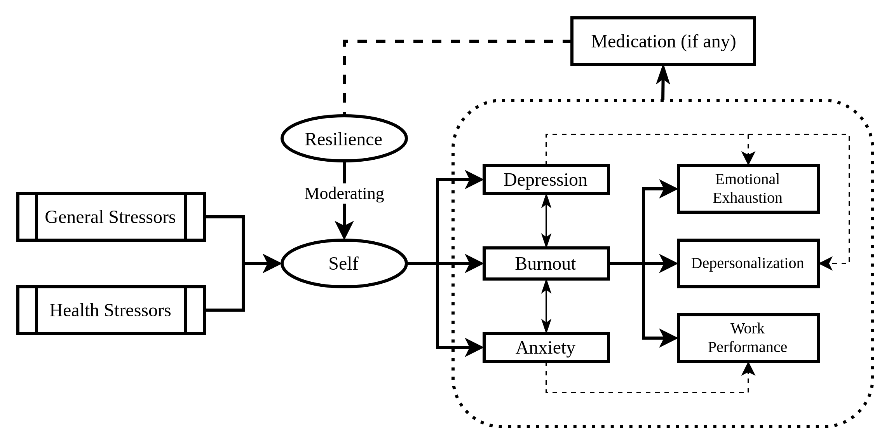

---
execute:
  freeze: false
---

```{r}

pkgs <- c("magrittr")
pkgs_load <- sapply(pkgs, library, character.only = TRUE)

```

# Research Framework

## Conceptual Framework \label{concept} {#sec-concept}

::: {.content-visible when-profile="rug"}

@fig-concept explains the conceptual framework of the proposed investigation. An individual perceives stressors, moderated by an adaptive resilience, resulting in a varying degree of psychological outcomes. Any medication taken during the course of observable diagnosis is presumed to affect the mental health, which in return influence the resilience. The theoretical remarks of resilience is further investigated in a scoping review (denoted by `#1` in the conceptual framework figure), conducted following the methods in [-@sec-scoping.rev]. The trend of medication uses (`#2`) is investigated following the methods in [-@sec-med].  Psychological outcomes (`#3`) are investigated following the methods in [-@sec-psych.method]. The methods measuring impacts of medication uses to mental resilience (`#4`) is described in section [-@sec-cost]. Lastly, the methods delineating the overall theoretical remarks (`#5`) is defined in section [-@sec-survey].

:::

```{r conceptual.framework}
#| label: fig-concept
#| fig.cap: Conceptual framework of how stressors are moderated by mental resilience in affecting the psychological outcome
#| fig-align: "center"
#| out.width: "90%"



```

## Operational Definition

```{r tbl-op-def}

yaml::read_yaml("op-definition.yml") %>%
  {Reduce(\(x, y) rbind(x, y), .)} %>%
  data.frame() %>%
  tibble::tibble() %>%
  knitr::kable()

```

## Research Hypothesis

The proposed research encompasses three main topics of interest, and the
hypotheses are ordered accordingly. For brevity, this section only enlist the
alternative hypotheses for each topic of interest.

::: {.content-visible when-profile="rug"}

1. Scoping review on resilience and mental health  
   *H~1~:* Resilience acts as a moderator of stressors and psychological
   outcomes.
1. Exploring the trend of medication uses   
   *H~1~:* There exists a seasonal pattern on the overtime trend of
   psychopharmaca uses.
1. Exploring the mental health profile before and during the pandemic  
   *H~1~:* The health perception is nuanced towards the change of environmental
   stressors and moderated by individual traits.
1. Cost-effectiveness analysis of policy measures to increase resilience  
   *H~1~:* Policies acting on institutional entities influence individual
   resilience.
1. Survey on mental resilience, burnout, and depression  
   *H~1~:* The resilient state is a moderator of stressor and psychological
   disorders.

:::

::: {.content-visible when-profile="proposal"}

1. What is the association between outcome-based resilience, measured via residual approach, and state resilience, measured with CD-RISC?  
   - *H~01~:* There is no significant association between outcome-based resilience and state resilience.
   - *H~11~:* Outcome-based resilience is positively correlated with state resilience.
1. What is the association between perceived stress and each mental health outcome: depression, anxiety, and burnout?  
   - *H~02a~:* There is no significant association between perceived stress and depression.
   - *H~12a~:* Perceived stress is positively associated with depression.
   - *H~02b~:* There is no significant association between perceived stress and anxiety.
   - *H~12b~:* Perceived stress is positively associated with anxiety.  
   - *H~02c~:* There is no significant association between perceived stress and burnout.  
   - *H~12c~:* Perceived stress is positively associated with burnout.
1. Does state resilience moderate the association between stress and each mental health outcome: depression, anxiety, and burnout?  
   - *H~03a~:* State resilience does not moderate the relationship between perceived stress and depression. 
   - *H~13a~:* State resilience moderates the relationship between perceived stress and depression, such that the positive association between stress and depression is weaker among individuals with higher state resilience.  
   - *H~03b~:* State resilience does not moderate the relationship between perceived stress and anxiety.  
   - *H~13b~:* State resilience moderates the relationship between perceived stress and anxiety, such that the positive association between stress and anxiety is weaker among individuals with higher state resilience.  
   - *H~03c~:* State resilience does not moderate the relationship between perceived stress and burnout.  
   - *H~13c~:* State resilience moderates the relationship between perceived stress and burnout, such that the positive association between stress and burnout is weaker among individuals with higher state resilience.

:::

:::{.content-hidden unless-profile="site"}

# References {-}

:::

